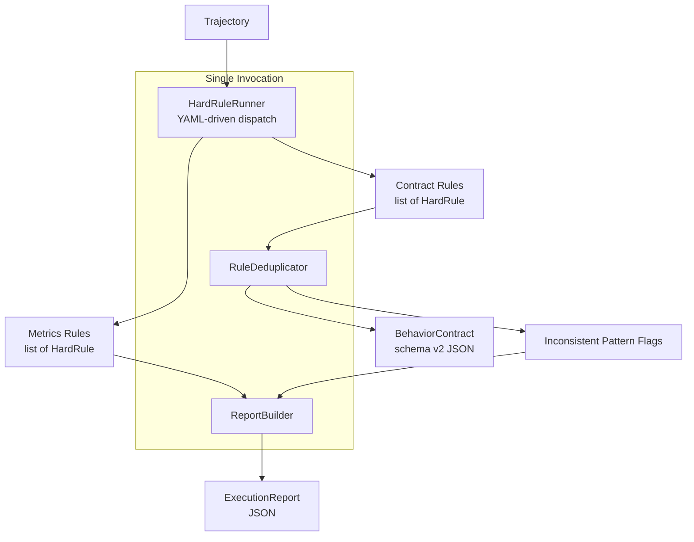

# Design Document — Contract Redesign

## Overview

This design restructures the trajectory evaluation compiler output into two distinct artifacts:

1. **Behavior Contract** — deterministic, step-agnostic invariants for regression and runtime validation (schema version 2).
2. **Execution Report** — behavioral observations, efficiency metrics, and unresolvable pattern flags.

The redesign introduces three major architectural changes:

- **Step-index elimination**: All contract rules express constraints in abstract terms (tool names, parameters, data-flow relationships) rather than positional step references. The internal `HardRule` hierarchy retains `step_index` as a working field during generation, but the compiler's final emit step strips it.
- **Rule deduplication**: A new `RuleDeduplicator` component sits between rule generation and contract emission. It groups raw rule instances by abstract identity (category + kind + target equivalence), detects inconsistencies, and merges consistent observations into single global invariants.
- **ToolSequence confidence heuristic**: Multi-signal confidence scoring replaces the current flat `medium` confidence, using data-dependency cross-referencing, a configurable "powerful couples" registry, and occurrence-count thresholds.

The `ToolIndexRule` is removed entirely. Per-step factories (`ToolParamTypeRule`, `ToolParamCountRule`) are promoted to trajectory-level factories that collect all observations then group/deduplicate internally.

---

## Architecture

### High-Level Pipeline Flow



### Component Responsibilities

| Component | Module | Responsibility |
|-----------|--------|----------------|
| `ContractCompiler` | `trajectory_eval/generator/contract_compiler.py` | Top-level orchestrator. Single entry point producing both artifacts. |
| `HardRuleRunner` | `trajectory_eval/generator/rule_runner.py` | YAML-driven dispatch (unchanged interface, modified registry). |
| `RuleDeduplicator` | `trajectory_eval/generator/deduplicator.py` | Groups, merges, and conflict-detects contract rules. |
| `RuleEmitter` | `trajectory_eval/generator/emitter.py` | Converts internal `HardRule` instances to `CompiledRule` (strips step indices). |
| `ReportBuilder` | `trajectory_eval/generator/report_builder.py` | Assembles the Execution Report from metrics + flags. |
| Concrete Rule Classes | `trajectory_eval/generator/rules/*` | Unchanged internal logic; `from_trajectory` factories. |

### Modified vs. New Modules

**New modules:**
- `trajectory_eval/generator/contract_compiler.py`
- `trajectory_eval/generator/deduplicator.py`
- `trajectory_eval/generator/emitter.py`
- `trajectory_eval/generator/report_builder.py`
- `trajectory_eval/models/execution_report.py`

**Modified modules:**
- `trajectory_eval/models/contract.py` — bump schema to v2, remove `step_index`/`step_range` from `RuleTarget`
- `trajectory_eval/generator/rule_runner.py` — remove ToolIndexRule from registry, add per-step rules to trajectory-level dispatch
- `trajectory_eval/generator/rules/tool_checks.py` — add `from_trajectory` classmethods, deprecate `from_step`
- `trajectory_eval/generator/rules/tool_sequence.py` — add confidence heuristic with multi-signal scoring
- `trajectory_eval/generator/rules/__init__.py` — remove `ToolIndexRule` export
- `trajectory_eval/generator/hard_rules.py` — deprecate `tool_call_rules`, add `compile_contract` facade
- `trajectory_eval/generator/hard_rules_config.yaml` — remove `tool_index` from per_step_rules, move param rules to trajectory_rules

**Removed:**
- `ToolIndexRule` class (entire class deleted from `tool_checks.py`)

---

## Components and Interfaces

### 1. ContractCompiler (Orchestrator)

```python
class ContractCompiler:
    """Top-level compiler producing both artifacts from a single trajectory."""
    
    def __init__(self, config_path: Optional[Path] = None) -> None: ...
    
    async def compile(
        self,
        trajectory: Trajectory,
        embed_client: Optional[AzureFoundryClient] = None,
    ) -> CompilerOutput: ...
```

`CompilerOutput` is a simple dataclass:

```python
@dataclass
class CompilerOutput:
    contract: BehaviorContract
    report: ExecutionReport
```

**Internal flow:**
1. Instantiate `HardRuleRunner` with config.
2. Run all rules → get `list[HardRule]`.
3. Classify each rule as contract-eligible or metrics-only (using `_CLASSIFICATION` registry).
4. Pass contract rules through `RuleEmitter` to produce `list[CompiledRule]`.
5. Pass emitted rules through `RuleDeduplicator` → deduplicated rules + inconsistency flags.
6. Build `BehaviorContract` from deduplicated rules.
7. Build `ExecutionReport` from metrics rules + inconsistency flags.

### 2. RuleEmitter (Internal Rule → CompiledRule)

Each concrete rule class gets a mapping function that knows how to convert its typed fields into the abstract `CompiledRule` format. This is implemented as a registry of emitter functions keyed by rule class:

```python
EmitterFn = Callable[[HardRule], CompiledRule]

_EMITTER_REGISTRY: dict[type, EmitterFn] = {
    DataDependencyRule: emit_data_dependency,
    ToolSequenceRule: emit_tool_sequence,
    ToolParamTypeRule: emit_param_type,
    ToolParamCountRule: emit_param_count,
    ToolResultTypeRule: emit_result_type,
    LlmResponseFormatRule: emit_llm_format,
    LlmGroundingRule: emit_llm_grounding,
    TerminalStateRule: emit_terminal_state,
    MutationMatcherRule: emit_mutation_matcher,
}
```

Each emitter function constructs a `CompiledRule` with:
- `category` — from the classification table
- `kind` — rule-specific string
- `target` — abstract `RuleTarget` (no step indices)
- `constraint` — rule-specific dict
- `cardinality` — one of `all`, `any`, `single` (determined by rule semantics: most rules use `all`; terminal state uses `single`)
- `metadata` — confidence + support=1 (pre-dedup)

### 3. RuleDeduplicator

```python
class RuleDeduplicator:
    """Merges overlapping per-step observations into global invariants."""
    
    def deduplicate(
        self, rules: list[CompiledRule]
    ) -> DeduplicationResult: ...

@dataclass
class DeduplicationResult:
    rules: list[CompiledRule]          # Deduplicated, re-numbered
    flags: list[InconsistencyFlag]     # Contradictory patterns
```

**Deduplication identity key**: `(category, kind, target_fingerprint)` where `target_fingerprint` is a canonical JSON serialization of the `RuleTarget` (excluding metadata-only fields).

**Algorithm:**
1. Group rules by identity key.
2. For each group:
   - If all `constraint` dicts are identical → merge into one rule, set `support = len(group)`, `confidence = max(group confidences)`.
   - If constraint dicts conflict → emit an `InconsistencyFlag`, do NOT emit a contract rule.
3. Re-assign sequential IDs: `rule_001`, `rule_002`, etc.

### 4. ReportBuilder

```python
class ReportBuilder:
    """Assembles the Execution Report from metrics and flags."""
    
    def build(
        self,
        metrics_rules: list[HardRule],
        flags: list[InconsistencyFlag],
    ) -> ExecutionReport: ...
```

### 5. ToolSequence Confidence Heuristic

The redesigned `ToolSequenceRule.from_trajectory` collects all A→B pairs then applies multi-signal scoring:

```python
def _compute_confidence(
    tool_a: str,
    tool_b: str,
    occurrences: int,
    has_data_flow: bool,
    powerful_couples: set[tuple[str, str]],
    threshold: int = 3,
) -> Optional[ConfidenceLevel]:
    """
    Returns confidence level or None (suppress the rule).
    
    Signals (any one = high confidence):
    1. Data-flow: B uses a param originating from A's output → high
    2. Powerful couple: (A, B) in registry → high
    3. Count threshold: occurrences >= threshold → high
    
    If none of the above: return None (do not emit rule).
    """
```

**Powerful couples registry** (configurable via YAML):
```yaml
powerful_couples:
  - [create_file, write_file]
  - [read_file, str_replace]
  - [list_directory, read_file]
  - [execute_command, read_output]
```

---

## Data Models

### BehaviorContract (schema v2)

```python
class RuleTarget(BaseModel):
    """Abstract target — NO step indices."""
    model_config = ConfigDict(extra="allow")
    
    tool: Optional[str] = None
    parameter: Optional[str] = None
    response: Optional[str] = None
    scope: Optional[Literal["trajectory"]] = None
    tool_pair: Optional[tuple[str, str]] = None
    entity: Optional[str] = None
    # REMOVED: step_index, step_range


class RuleCardinality(str, Enum):
    """How many instances of the target the rule applies to.
    
    Attributes:
        all: Rule must hold for EVERY instance of the target.
        any: Rule must hold for AT LEAST ONE instance of the target.
        single: Rule applies to exactly one specific instance (e.g., first or last).
    """
    all = "all"
    any = "any"
    single = "single"


class CompiledRule(BaseModel):
    id: str
    category: RuleCategory
    kind: str
    target: RuleTarget
    constraint: dict[str, Any]
    cardinality: RuleCardinality
    metadata: RuleMetadata


class BehaviorContract(BaseModel):
    """Top-level contract envelope — schema version 2."""
    schema_version: Literal[2] = 2
    generator: GeneratorInfo = Field(default_factory=GeneratorInfo)
    evidence: Evidence
    rules: list[CompiledRule]
```

### ExecutionReport

```python
class MetricObservation(BaseModel):
    """A single metrics-rule observation."""
    rule_class: str              # e.g. "RedundancyRateRule"
    category: str                # e.g. "efficiency"
    observation: dict[str, Any]  # Rule-specific payload


class InconsistencyFlag(BaseModel):
    """A contradictory pattern that could not be resolved."""
    target_fingerprint: str
    category: RuleCategory
    kind: str
    conflicting_constraints: list[dict[str, Any]]
    observation_count: int


class ExecutionReport(BaseModel):
    """Secondary output artifact — metrics + flags."""
    schema_version: Literal[1] = 1
    generator: GeneratorInfo = Field(default_factory=GeneratorInfo)
    metrics: list[MetricObservation]
    flags: list[InconsistencyFlag]
```

### Rule Classification Table

| Rule Class | Artifact | Category | Kind | Cardinality |
|-----------|----------|----------|------|-------------|
| `DataDependencyRule` | Contract | `provenance` | `data_lineage` | `all` |
| `ToolSequenceRule` | Contract | `workflow` | `tool_ordering` | `all` |
| `ToolParamTypeRule` | Contract | `interface` | `param_type` | `all` |
| `ToolParamCountRule` | Contract | `interface` | `param_count` | `all` |
| `ToolResultTypeRule` | Contract | `interface` | `result_format` | `all` |
| `LlmResponseFormatRule` | Contract | `interface` | `response_format` | `all` |
| `LlmGroundingRule` | Contract | `grounding` | `entity_reference` | `all` |
| `TerminalStateRule` | Contract | `termination` | `completion_signal` | `single` |
| `MutationMatcherRule` | Contract | `adaptation` | `failure_recovery` | `all` |
| `RedundancyRateRule` | Report | — | `redundancy_rate` | — |
| `TokenEfficiencyRule` | Report | — | `token_growth` | — |
| `MonotonicProgressRule` | Report | — | `stagnation` | — |
| `CycleBreakRule` | Report | — | `cycle_detection` | — |
| `ToolIndexRule` | **REMOVED** | — | — | — |

### Emitter Output Examples

**DataDependencyRule → CompiledRule:**
```json
{
  "id": "rule_001",
  "category": "provenance",
  "kind": "data_lineage",
  "target": {"tool": "str_replace", "parameter": "path"},
  "constraint": {
    "must_originate_from": {"tool": "read_file", "output_field": "path"}
  },
  "cardinality": "all",
  "metadata": {"confidence": "high", "support": 4}
}
```

**ToolSequenceRule → CompiledRule:**
```json
{
  "id": "rule_002",
  "category": "workflow",
  "kind": "tool_ordering",
  "target": {"tool_pair": ["read_file", "str_replace"]},
  "constraint": {
    "condition": "a_succeeds",
    "behavior": "b_valid"
  },
  "cardinality": "all",
  "metadata": {"confidence": "high", "support": 7}
}
```

**ToolParamTypeRule → CompiledRule:**
```json
{
  "id": "rule_003",
  "category": "interface",
  "kind": "param_type",
  "target": {"tool": "str_replace", "parameter": "old_str"},
  "constraint": {"expected_type": "str"},
  "cardinality": "all",
  "metadata": {"confidence": "high", "support": 12}
}
```

**MutationMatcherRule → CompiledRule:**
```json
{
  "id": "rule_005",
  "category": "adaptation",
  "kind": "failure_recovery",
  "target": {"tool": "execute_command"},
  "constraint": {
    "on_failure": "agent_must_adapt",
    "adaptation_required": true
  },
  "cardinality": "all",
  "metadata": {"confidence": "high", "support": 3}
}
```

**TerminalStateRule → CompiledRule:**
```json
{
  "id": "rule_006",
  "category": "termination",
  "kind": "completion_signal",
  "target": {"scope": "trajectory"},
  "constraint": {
    "completion_keywords": ["done", "complete", "finished", "resolved"],
    "terminal_condition": "last_step_contains_keyword"
  },
  "cardinality": "single",
  "metadata": {"confidence": "medium", "support": 1}
}
```

---

### Deduplication Algorithm (Detailed)

```python
def deduplicate(self, rules: list[CompiledRule]) -> DeduplicationResult:
    groups: dict[str, list[CompiledRule]] = defaultdict(list)
    
    for rule in rules:
        key = self._identity_key(rule)
        groups[key].append(rule)
    
    deduplicated: list[CompiledRule] = []
    flags: list[InconsistencyFlag] = []
    seq = 0
    
    for key, group in groups.items():
        constraints = [r.constraint for r in group]
        
        if self._all_consistent(constraints):
            seq += 1
            merged = CompiledRule(
                id=f"rule_{seq:03d}",
                category=group[0].category,
                kind=group[0].kind,
                target=group[0].target,
                constraint=constraints[0],  # All identical
                cardinality=group[0].cardinality,
                metadata=RuleMetadata(
                    confidence=max(r.metadata.confidence for r in group),
                    support=len(group),
                ),
            )
            deduplicated.append(merged)
        else:
            flags.append(InconsistencyFlag(
                target_fingerprint=key,
                category=group[0].category,
                kind=group[0].kind,
                conflicting_constraints=constraints,
                observation_count=len(group),
            ))
    
    return DeduplicationResult(rules=deduplicated, flags=flags)

def _identity_key(self, rule: CompiledRule) -> str:
    """Canonical fingerprint: (category, kind, sorted target JSON)."""
    target_dict = rule.target.model_dump(exclude_none=True)
    target_json = json.dumps(target_dict, sort_keys=True)
    return f"{rule.category.value}::{rule.kind}::{target_json}"

def _all_consistent(self, constraints: list[dict]) -> bool:
    """True when all constraint dicts in the group are identical."""
    if len(constraints) <= 1:
        return True
    canonical = json.dumps(constraints[0], sort_keys=True)
    return all(
        json.dumps(c, sort_keys=True) == canonical
        for c in constraints[1:]
    )
```

**Confidence ordering** for `max()`: `high > medium > low` (the `ConfidenceLevel` enum already supports comparison via its string ordering, or we add `__lt__` if needed).

---

### ToolSequence Confidence Heuristic (Detailed)

The redesigned `ToolSequenceRule.from_trajectory` operates in two phases:

**Phase 1: Collect all A→B pairs**
```python
pairs: dict[tuple[str, str], list[ToolSequenceObservation]] = defaultdict(list)
# For each tool_result step, find preceding call A and following call B
# Record (tool_a, tool_b) with result status
```

**Phase 2: Score and filter**
```python
for (tool_a, tool_b), observations in pairs.items():
    # Count consistent occurrences (A succeeds → B follows)
    success_count = sum(1 for o in observations if o.a_succeeded)
    
    # Signal 1: Data-flow dependency
    has_data_flow = _check_data_dependency(tool_a, tool_b, trajectory)
    
    # Signal 2: Powerful couple
    is_powerful_couple = (tool_a, tool_b) in powerful_couples_registry
    
    # Signal 3: Count threshold
    meets_threshold = success_count >= confidence_threshold
    
    if has_data_flow or is_powerful_couple or meets_threshold:
        confidence = ConfidenceLevel.high
    else:
        # Below threshold, no structural evidence → suppress
        continue  # Do NOT emit rule
    
    # Check for inconsistency (sometimes B follows, sometimes not)
    if _is_inconsistent(observations):
        # Route to flags instead
        continue
    
    rules.append(ToolSequenceRule(..., confidence=confidence))
```

**Data-flow cross-reference** (`_check_data_dependency`):
- Look at `DataDependencyRule` instances already generated for this trajectory.
- If any `DataDependencyRule` shows tool_b's parameter originating from tool_a's output → data-flow link confirmed.

---

### Per-Step Rule Promotion (ToolParamTypeRule, ToolParamCountRule)

Both rules gain a `from_trajectory` classmethod that replaces the per-step `from_step` factory:

```python
class ToolParamTypeRule(HardRule):
    @classmethod
    def from_trajectory(cls, trajectory: Trajectory) -> list["ToolParamTypeRule"]:
        """Scan ALL tool_call steps, collect type observations per (tool, param)."""
        observations: dict[tuple[str, str], list[ToolParamTypeRule]] = defaultdict(list)
        
        for step in trajectory.steps:
            if step.step_type != StepType.tool_call or not step.tool_input:
                continue
            tool_name = step.tool_name or ""
            for key, val in step.tool_input.items():
                rule = cls(
                    id=f"tool_params_{step.index}_{key}_type",
                    step_index=step.index,
                    tool_name=tool_name,
                    param_key=key,
                    expected_type=type(val).__name__,
                )
                observations[(tool_name, key)].append(rule)
        
        # Return ALL observations — deduplication happens downstream
        return [rule for group in observations.values() for rule in group]
```

The `tool_call_rules` facade is deprecated but retained for backward compatibility (logs a deprecation warning). The `HardRuleRunner` registry gains entries for `tool_param_type` and `tool_param_count`.

---

### Migration Path per Rule Class

| Rule Class | Current State | Migration Action |
|-----------|---------------|------------------|
| `ToolIndexRule` | Per-step factory, exported | **Delete entirely.** Remove from `__init__.py`, remove from YAML config, remove from `hard_rules.py` facade. |
| `ToolParamTypeRule` | Per-step `from_step` only | Add `from_trajectory` classmethod. Move to `trajectory_rules` in YAML. Deprecate `from_step`. |
| `ToolParamCountRule` | Per-step `from_step` only | Add `from_trajectory` classmethod. Move to `trajectory_rules` in YAML. Deprecate `from_step`. |
| `ToolSequenceRule` | Trajectory-level, flat confidence | Add confidence heuristic. Accept `powerful_couples` and `confidence_threshold` config. |
| `DataDependencyRule` | Trajectory-level, step-index in output | No internal change. Emitter converts `source_step` → `(source_tool, output_field)`. |
| `ToolResultTypeRule` | Trajectory-level | No internal change. Emitter strips step_index. |
| `LlmResponseFormatRule` | Trajectory-level | No internal change. Emitter uses `response: "assistant"` target. |
| `LlmGroundingRule` | Trajectory-level | No internal change. Emitter uses `entity` target. |
| `TerminalStateRule` | Trajectory-level | No internal change. Emitter uses `scope: "trajectory"` target. |
| `MutationMatcherRule` | Trajectory-level | No internal change. Emitter uses tool target (the failed tool). |
| `RedundancyRateRule` | Trajectory-level (metrics) | No change. Routed to ExecutionReport. |
| `TokenEfficiencyRule` | Trajectory-level (metrics) | No change. Routed to ExecutionReport. |
| `MonotonicProgressRule` | Trajectory-level (metrics) | No change. Routed to ExecutionReport. |
| `CycleBreakRule` | Trajectory-level (metrics) | No change. Routed to ExecutionReport. |

---


## Correctness Properties

*A property is a characteristic or behavior that should hold true across all valid executions of a system — essentially, a formal statement about what the system should do. Properties serve as the bridge between human-readable specifications and machine-verifiable correctness guarantees.*

### Property 1: Compiled Rule Structural Completeness

*For any* trajectory that produces at least one contract rule, every `CompiledRule` in the output SHALL have all seven required fields (`id`, `category`, `kind`, `target`, `constraint`, `cardinality`, `metadata`) with `category` drawn from the `RuleCategory` enum, `cardinality` drawn from `{all, any, single}`, `metadata.confidence` drawn from `{high, medium, low}`, and `metadata.support >= 1`.

**Validates: Requirements 1.3, 1.4, 1.5, 1.7, 1.8, 1.9, 1.10, 1.11**

### Property 2: Step-Index Elimination

*For any* trajectory compiled into a `BehaviorContract`, the JSON serialization of the `rules` array SHALL NOT contain any field named `step_index`, `step_range`, or any integer value interpretable as a positional step reference within `target` or `constraint` objects. Specifically, `target.model_dump(exclude_none=True)` SHALL NOT contain keys `step_index` or `step_range`.

**Validates: Requirements 2.1, 2.2, 2.3, 2.4, 2.5, 5.2**

### Property 3: Correct Rule Routing

*For any* trajectory compiled by `ContractCompiler`, every rule in the `BehaviorContract.rules` array SHALL have a `category` belonging to `{provenance, workflow, interface, adaptation, grounding, termination}` and SHALL NOT originate from a metrics-only rule class (`RedundancyRateRule`, `TokenEfficiencyRule`, `MonotonicProgressRule`, `CycleBreakRule`). Conversely, all metrics-rule observations SHALL appear in the `ExecutionReport.metrics` section and SHALL NOT appear in the contract.

**Validates: Requirements 3.1, 3.2, 3.3, 3.4, 3.5, 3.6, 3.7, 3.8, 3.9, 4.1, 4.2, 4.3, 4.4, 4.5**

### Property 4: Deduplication Merges Identical Rules

*For any* list of `CompiledRule` instances where N rules share the same identity key `(category, kind, target_fingerprint)` and identical `constraint` dicts, the `RuleDeduplicator` SHALL produce exactly one output rule with `metadata.support == N` and `metadata.confidence == max(input confidences)`.

**Validates: Requirements 6.1, 6.2, 6.3, 6.5, 6.6, 8.4, 9.4, 12.3**

### Property 5: Deduplication IDs Are Sequential and Unique

*For any* deduplication output containing K rules, the IDs SHALL match the pattern `rule_\d{3}` (e.g., `rule_001`, `rule_002`, ..., `rule_K`) and SHALL be unique across all rules in the output.

**Validates: Requirements 6.4**

### Property 6: Conflicting Rules Produce Flags, Not Contract Rules

*For any* list of `CompiledRule` instances where rules sharing the same identity key `(category, kind, target_fingerprint)` have differing `constraint` dicts, the `RuleDeduplicator` SHALL NOT emit a contract rule for that target AND SHALL produce an `InconsistencyFlag` containing the conflicting constraint values and the observation count.

**Validates: Requirements 7.1, 7.2, 7.3**

### Property 7: Emitter Produces Correct Abstract Structure

*For any* internal `HardRule` instance of a contract-eligible class, the corresponding `RuleEmitter` function SHALL produce a `CompiledRule` whose `target` identifies the subject using only abstract identifiers (tool names, parameter keys, `"assistant"` response, `"trajectory"` scope, tool_pair tuples, or entity values) and whose `constraint` dict contains the rule-class-specific required keys:
- `DataDependencyRule` → `constraint.must_originate_from` with `tool` and `output_field`
- `ToolSequenceRule` → `target.tool_pair` + `constraint.condition` and `constraint.behavior`
- `ToolParamTypeRule` → `target.tool`, `target.parameter`, `constraint.expected_type`
- `ToolParamCountRule` → `target.tool`, `constraint.expected_count`
- `ToolResultTypeRule` → `target.tool`, `constraint.expected_format`
- `LlmResponseFormatRule` → `target.response == "assistant"`, `constraint.expected_format`
- `LlmGroundingRule` → `target.entity`, `constraint` describes integrity requirement
- `TerminalStateRule` → `target.scope == "trajectory"`, `constraint.completion_keywords`
- `MutationMatcherRule` → `target.tool`, `constraint` describes adaptation behavior, `category == adaptation`, `kind == "failure_recovery"`

**Validates: Requirements 8.1, 8.2, 8.3, 9.1, 9.2, 9.3, 10.1, 10.2, 10.3, 10.4, 10.5, 10.6, 10.7, 10.8, 11.1, 11.2, 11.3, 11.4, 12.1, 12.2, 12.4**

### Property 8: Confidence Heuristic — Any Qualifying Signal Yields High

*For any* tool pair (A, B) where at least one of the following signals is present — (1) B uses a parameter originating from A's output (data-flow), (2) (A, B) is in the powerful_couples registry, or (3) the pair is observed >= `confidence_threshold` times — the emitted `ToolSequenceRule` SHALL have `confidence == high`.

**Validates: Requirements 9.5, 9.6, 9.7**

### Property 9: Below-Threshold Pairs Are Suppressed

*For any* tool pair (A, B) observed fewer than `confidence_threshold` times AND without data-flow dependency AND not in the powerful_couples registry, the `ContractCompiler` SHALL NOT emit a contract rule for that pair.

**Validates: Requirements 9.8**

### Property 10: Contract Serialization Round-Trip

*For any* valid `BehaviorContract` object, serializing it to JSON via `model_dump_json()` and then parsing back via `BehaviorContract.model_validate_json()` SHALL produce an object equal to the original.

**Validates: Requirements 16.3**

### Property 11: Both Artifacts Produced

*For any* valid `Trajectory` input (including empty trajectories with zero tool calls), the `ContractCompiler.compile()` method SHALL return a `CompilerOutput` containing both a `BehaviorContract` and an `ExecutionReport`.

**Validates: Requirements 13.1, 14.1**

### Property 12: Fault Tolerance

*For any* trajectory where one contract-eligible rule's `from_trajectory` raises an exception, the `ContractCompiler` SHALL still produce a valid `BehaviorContract` containing rules from all other non-failing rule classes, and SHALL log the error.

**Validates: Requirements 14.5**

---

## Error Handling

### Rule Execution Failures

The existing fault-tolerance pattern in `HardRuleRunner.run()` (broad `except Exception` with logging and continuation) is preserved. The `ContractCompiler` wraps the entire pipeline with the same guarantee: one failing rule class cannot crash the compilation.

**Behavior:**
- Log the exception at ERROR level with rule name and traceback.
- Skip the failing rule's output entirely (do not include partial results).
- Continue processing all remaining rules.
- The final contract and report are valid even if some rules failed.

### Deduplication Edge Cases

| Scenario | Handling |
|----------|----------|
| Empty input (no rules) | Return empty contract (`rules: []`) and report (`metrics: [], flags: []`). |
| Single observation for a target | Emit as-is with `support=1`. No merge needed. |
| Mixed confidences in a consistent group | Take the highest confidence. |
| All rules for one class fail | That class contributes zero rules; other classes unaffected. |

### Serialization Errors

- `BehaviorContract.model_validate_json(invalid_json)` raises `pydantic.ValidationError` with field-level detail.
- The public `parse_contract(json_str: str) -> BehaviorContract` helper wraps this and raises `ContractParseError` with the schema violation description.

### Configuration Errors

- Missing YAML config file → raise `FileNotFoundError` at `ContractCompiler.__init__`.
- Unknown rule key in YAML → log warning, skip (same as current `HardRuleRunner` behavior).
- Invalid powerful_couples format → raise `ValueError` at config load with descriptive message.

---

## Testing Strategy

### Dual Testing Approach

This feature is well-suited to property-based testing because:
- The core components (emitter, deduplicator, compiler) are pure functions with clear input/output.
- Universal properties hold across all valid inputs (any trajectory, any rule combination).
- The input space is large (arbitrary trajectories, arbitrary rule combinations).

**Property-based tests** verify the 12 correctness properties above using Hypothesis (Python PBT library).

**Unit tests** cover:
- Specific emitter functions with concrete examples.
- Edge cases (empty trajectory, trajectory with only metrics rules, etc.).
- YAML configuration loading.
- Error paths (invalid JSON parsing, missing config).

### Property-Based Testing Configuration

- Library: **Hypothesis** (already in Python ecosystem, standard for Pydantic projects)
- Minimum iterations: **100** per property test
- Each test tagged with: `# Feature: contract-redesign, Property {N}: {description}`
- Custom strategies for generating:
  - `Trajectory` instances with realistic step sequences
  - `HardRule` instances of various concrete types
  - `CompiledRule` instances with varying targets and constraints
  - `BehaviorContract` instances for round-trip testing

### Test Organization

```
tests/
  test_contract_redesign/
    test_emitter.py           # Unit tests per emitter function
    test_deduplicator.py      # Unit + property tests for dedup logic
    test_compiler.py          # Integration tests for full pipeline
    test_confidence.py        # Property tests for ToolSequence confidence
    test_serialization.py     # Round-trip property tests
    test_routing.py           # Property tests for rule classification
    conftest.py               # Hypothesis strategies (shared generators)
```

### Key Test Strategies (Hypothesis)

```python
# Strategy for generating a valid CompiledRule
@st.composite
def compiled_rules(draw):
    category = draw(st.sampled_from(list(RuleCategory)))
    kind = draw(st.text(min_size=1, max_size=20, alphabet=st.characters(whitelist_categories=('L', 'N', '_'))))
    tool = draw(st.text(min_size=1, max_size=30))
    # ... build target and constraint based on category
    return CompiledRule(...)

# Strategy for generating N identical rules (for dedup testing)
@st.composite
def identical_rule_group(draw, min_size=2, max_size=10):
    base = draw(compiled_rules())
    n = draw(st.integers(min_value=min_size, max_value=max_size))
    return [base.model_copy(update={"id": f"temp_{i}"}) for i in range(n)]
```

### Migration Testing

- **Backward compatibility**: Ensure the deprecated `tool_call_rules()` facade still works (emits deprecation warning, excludes ToolIndexRule).
- **Schema migration**: Verify that old schema-v1 contracts are rejected by the v2 parser with a clear error message.
- **Config migration**: Verify that old YAML configs (with `tool_index` in `per_step_rules`) are handled gracefully (logged warning, rule skipped).
