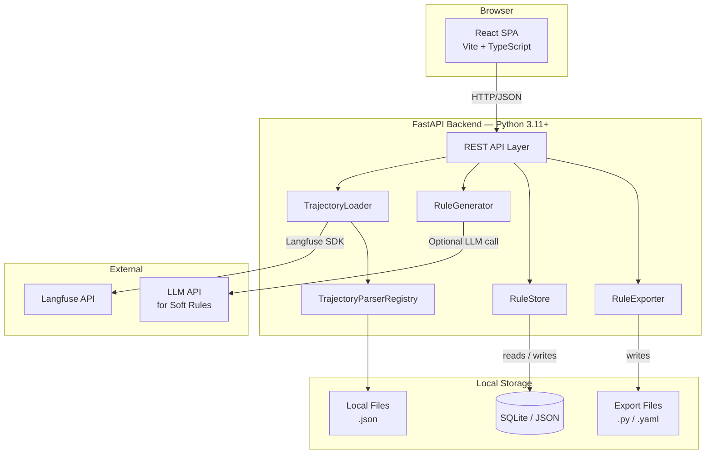
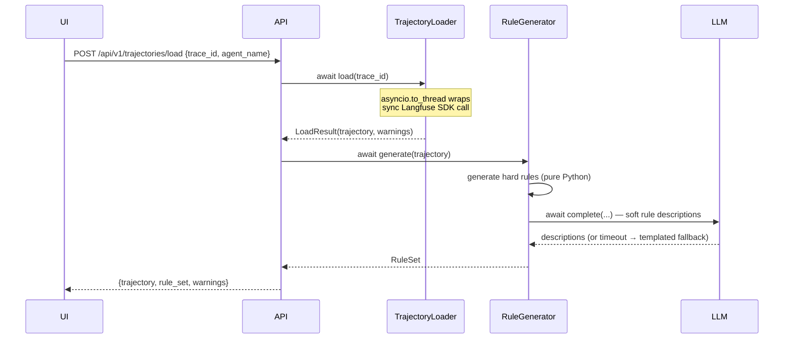
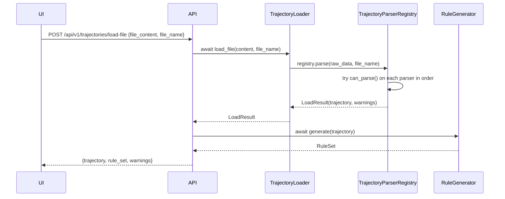

# Design Document — Trajectory Evaluation System

## Overview

The Trajectory Evaluation System is a standalone web application that ingests LLM-agent execution traces from Langfuse or from local trajectory files on disk, automatically generates evaluation rules from those traces, lets users review and approve the rules, and exports the approved rules as runnable test artifacts (pytest files and DeepEval YAML).

The system follows a linear, session-oriented workflow:

```
Load Trajectory → Generate Rules → Review & Approve → Export
```

The backend is a Python FastAPI service that owns all business logic (ingestion, rule generation, persistence, export). The frontend is a React single-page application that provides the review UI. Both components run locally on the developer's machine — there are no cloud deployments.

Key design goals:
- **No external AI dependency for hard rules.** All deterministic rules are generated with pure Python logic.
- **Minimal footprint.** Local SQLite (or JSON) persistence; no Docker or external databases required.
- **Extensible rule generation.** Rule generators are strategy objects; adding a new step type requires adding one generator class.
- **Reliable serialization.** The Trajectory model uses Pydantic v2 with strict typing and deterministic JSON output.
- **Type-safe rule export.** Hard rules carry a typed `PseudocodeExpression` IR; export is a deterministic `match` with no string parsing.
- **Extensible local file loading.** Parser implementations are strategy objects registered in a `TrajectoryParserRegistry`; adding a new file format requires adding one parser class.
- **LLM-curated anchor rules.** The existing soft-rule LLM call on every `llm_response` step is extended to return 0–3 `Anchor_Facts`; each becomes a candidate `ContainsCheck` Hard_Rule at zero extra LLM cost.
- **Tool-call appropriateness evaluation.** The existing `tool_result` Soft_Rule (result plausibility) is extended into a single combined LLM call that also evaluates whether the tool selection itself was appropriate given the preceding trajectory context.

---

## Architecture

### High-Level Component View



### Request / Response Flow



### Local File Load Flow



---

## Components and Interfaces

### 1. TrajectoryLoader

Responsible for fetching a trace from Langfuse and converting it into the canonical `Trajectory` model.

```python
class TrajectoryLoader:
    async def load(self, trace_id: str) -> LoadResult: ...          # existing — Langfuse
    async def load_file(self, content: str, file_name: str) -> LoadResult: ...  # new — local file
```

**Responsibilities:**
- Validate `trace_id` (1–200 characters, non-empty).
- Call the Langfuse Python SDK via `asyncio.to_thread` (the SDK is synchronous; wrapping it keeps the FastAPI event loop unblocked during the network call and honours the 10-second timeout via `asyncio.wait_for`).
- Map each observation to one or more `Step` objects using the mapping table in Requirement 2.2.
- Sort or reorder steps by ascending timestamp (configurable; default reorder).
- Populate missing required fields with typed nulls and record warnings.
- Return a `LoadResult` containing the `Trajectory` and a list of `WarningEntry` objects, or a typed `LoadErrorCode` + message on failure.

**`load_file` responsibilities:**
- Validate file size ≤ 50 MB (raw content byte length).
- Delegate to `TrajectoryParserRegistry.parse(content, file_name)`.
- Wrap I/O errors into `LoadResult` with appropriate error messages per Requirements 11.4–11.7.
- Return the same `LoadResult` shape as `load()`.

**Error mapping:**

| Langfuse exception | Returned message |
|---|---|
| `AuthenticationError` | `"Langfuse authentication failed. Check your API key and host configuration."` |
| `NotFoundError` | `"Trace not found."` |
| `TimeoutError` (> 10 s) | `"Langfuse connection timed out."` |
| File not found | `"File not found: <file_path>"` |
| File unreadable (permission/I/O) | `"File could not be read: <reason>"` |
| No matching parser | `"Unrecognized trajectory format."` |
| Parser found, content malformed | `"Parse error (<format_name>): <description>"` |

**Configuration (environment variables):**

| Variable | Default | Purpose |
|---|---|---|
| `LANGFUSE_HOST` | `https://cloud.langfuse.com` | Langfuse API host |
| `LANGFUSE_PUBLIC_KEY` | *(required)* | Langfuse public key |
| `LANGFUSE_SECRET_KEY` | *(required)* | Langfuse secret key (for retrieving traces) |
| `TRAJECTORY_STEP_ORDER` | `reorder` | How to handle out-of-order timestamps: `reorder` (sort by ascending timestamp) or `reject` (return error) |

---

### 1b. TrajectoryParserRegistry

Maintains an ordered list of `TrajectoryParser` implementations and dispatches format detection and parsing for local trajectory files.

```python
class TrajectoryParser(Protocol):
    format_name: str
    def can_parse(self, raw_data: str) -> bool: ...
    def parse(self, raw_data: str, file_name: str) -> LoadResult: ...

class TrajectoryParserRegistry:
    def __init__(self) -> None: ...
    def register(self, parser: TrajectoryParser) -> None: ...
    def parse(self, raw_data: str, file_name: str) -> LoadResult: ...
```

**Responsibilities:**
- Maintains an ordered list of `TrajectoryParser` implementations.
- `register(parser)`: appends the parser; if a parser with the same `format_name` already exists, replaces it in-place (preserving its position in the ordered list) rather than appending a duplicate.
- `parse(raw_data, file_name)`: iterates registered parsers in order, calls `can_parse()` on each (catching and swallowing exceptions, treating them as `False`), and delegates to the first matching parser's `parse()`. Returns `LoadResult(success=False, error_message="Unrecognized trajectory format.")` if no parser matches.
- Auto-registers built-in parsers at module import time (not at FastAPI startup), so the registry is usable in tests without starting the full application.

**Built-in parsers registered by default:**

| Format | Class | `format_name` |
|---|---|---|
| OpenAI Messages | `OpenAIMessagesParser` | `"openai_messages"` |

**File locations:**
- Registry: `trajectory_eval/loader/parser_registry.py`
- Parser protocol: `trajectory_eval/loader/parsers/base.py`
- OpenAI parser: `trajectory_eval/loader/parsers/openai_messages.py`

---

### 1c. OpenAIMessagesParser

Parses trajectory files stored in OpenAI-style chat completion messages format (a JSON array of role/content objects).

```python
class OpenAIMessagesParser:
    format_name: str = "openai_messages"

    def can_parse(self, raw_data: str) -> bool:
        """Returns True iff raw_data is a JSON array where every element
        has a 'role' field of type str. An empty array returns True."""

    def parse(self, raw_data: str, file_name: str) -> LoadResult:
        """Maps role/content objects to Steps; returns LoadResult."""
```

**Role → Step mapping table:**

| `role` value | Mapped `Step_Type` | Field mapping |
|---|---|---|
| `"system"` | *(skipped)* | — |
| `"user"` | `user_message` | `content` → `prompt` |
| `"assistant"` | `llm_response` and/or `tool_call` | If `tool_calls` list is present and non-empty: if `content` is present and non-null, maps to an `llm_response` (`content` → `response`). Then, maps each item in `tool_calls` to a consecutive `tool_call` Step (`function.name` → `tool_name`, `function.arguments` parsed as JSON → `tool_input`). Otherwise (no `tool_calls`), maps to a single `llm_response` (`content` → `response`, null if absent). |
| `"tool"` | `tool_result` | `content` → `tool_output` |
| *(other)* | *(skipped + warning)* | `WarningEntry` recorded |

**Synthetic timestamps:** Unix epoch (1970-01-01T00:00:00Z) + `step_index` seconds, where `step_index` is the zero-based index of the Step within the resulting Steps list. `latency_ms`, `token_count`, and `cost_usd` are set to 0 for every Step.

**Trajectory timing:** `start_time` = epoch + 0 s; `end_time` = epoch + (N − 1) s where N = number of Steps. Both are set to epoch if the Steps list is empty.

**Trajectory metadata:**
- `id` = file stem (last extension stripped, e.g. `"run.v2.json"` → `"run.v2"`)
- `source_platform` = `"openai_messages"`
- `agent_name` = `None`
- `total_latency_ms` = 0, `total_token_count` = 0, `total_cost_usd` = 0.0

**Error handling:** If an element is missing `role` or `role` is not a string, return `LoadResult(success=False, error_message="Parse error (openai_messages): element at index <i> is missing a string 'role' field")`.

---

### 2. RuleGenerator

Produces a `RuleSet` from a validated `Trajectory`. Hard rules are generated purely with Python; soft rules optionally invoke an LLM.

```python
class RuleGenerator:
    async def generate(self, trajectory: Trajectory) -> RuleSet: ...
```

**Internal architecture — Strategy pattern:**

```
RuleGenerator
  ├── NodeRuleGeneratorStrategy (abstract)
  │     ├── ToolCallRuleGenerator
  │     ├── LLMResponseRuleGenerator
  │     ├── ToolResultRuleGenerator
  │     ├── UserMessageRuleGenerator
  │     └── ErrorStepRuleGenerator
  └── GlobalRuleGenerator
```

Each concrete strategy receives a `Step` (for node-level) or the full `Trajectory` (for global) and returns a list of `Rule` objects. Each strategy is responsible for constructing the typed `PseudocodeExpression` IR for every hard rule it produces; the `pseudocode: str` display field is derived from the IR by calling `expression_to_pseudocode(expr)` — a pure function defined in `trajectory_eval/models/expressions.py`.

**LLMResponseRuleGenerator — Anchor Hard-Rules via Extended LLM Response:**

The `LLMResponseRuleGenerator` no longer generates regex-based `ContainsCheck` rules (named entities, numeric literals, JSON key tokens). Instead, the single LLM call per `llm_response` step (already made for the Soft_Rule description) is extended to return a structured JSON payload:

```json
{
  "soft_rule_description": "The response at step N is relevant to...",
  "anchor_facts": [
    {"value": "42.5", "justification": "The computed result; a change would indicate a different calculation."},
    {"value": "Paris", "justification": "The named answer; a change would indicate wrong retrieval."}
  ]
}
```

- `anchor_facts` is a list of 0–3 objects, each with a `value` (string, ≤200 chars) and `justification` (one sentence).
- Each `anchor_fact` entry generates one `ContainsCheck` Hard_Rule with:
  - `expression = ContainsCheck(container=f"step[{i}].response", value=anchor_fact.value)`
  - `pseudocode` derived from the IR as usual
  - `confidence` = `high` if `anchor_fact.value` appears as a case-sensitive substring in `tool_input` or `tool_output` of any `tool_call`/`tool_result` step within `RULE_ANCHOR_WINDOW` steps (default 2, configurable); otherwise `medium`
  - `justification` stored on the `Rule` as a new optional string field
- On LLM call failure or timeout (30 s): zero anchor Hard_Rules generated, warning appended to `LoadResult`; Soft_Rule uses the templated fallback description.

**Confidence Assignment:**

| Rule origin | Confidence |
|---|---|
| `tool_call` Hard_Rules | `high` |
| `tool_result` Hard_Rules (key-presence, type checks) | `high` |
| `llm_response` anchor Hard_Rule — value found in nearby tool step | `high` |
| `llm_response` anchor Hard_Rule — value NOT in nearby tool step | `medium` |
| `llm_response` Soft_Rule (relevance-to-prompt) | `medium` |
| `tool_result` Soft_Rules (tool_call_appropriateness + result_plausibility) | `medium` |
| `user_message` Hard_Rule (len > 0) | `low` |
| `error` Hard_Rules | `low` |
| Global Hard_Rules (bounds, step-type presence) | `medium` |
| Global Soft_Rules | `low` |

Configuration: `RULE_ANCHOR_WINDOW` env var (default `2`) controls how many steps before and after the `llm_response` step are checked for verbatim substring matches. `TOOL_CONTEXT_WINDOW` env var (default `3`) controls how many preceding steps are included as context in the tool-pair LLM prompt (see `ToolResultRuleGenerator` section below).

**ToolResultRuleGenerator — Combined Appropriateness + Plausibility LLM Call:**

When a `tool_result` step is encountered, the generator makes a single LLM call that covers both the `tool_call` and `tool_result` steps together. The LLM prompt includes:
- **Preceding context window**: up to N steps before the `tool_call` step, each represented as a structured summary `{step_index, step_type, key_fields}`. N is read from env var `TOOL_CONTEXT_WINDOW` (default 3).
- **Tool name** and **tool input** (args) from the `tool_call` step at `step_index - 1`.
- **Tool output** from the current `tool_result` step.

The LLM returns a structured JSON response:

```json
{
  "tool_call_appropriateness": "Plain-English judgment of whether this tool call was the right choice given context.",
  "result_plausibility": "Plain-English judgment of whether the result plausibly follows from the inputs."
}
```

`tool_call_appropriateness` is evaluated on four criteria:
1. **Tool-goal fit** — is this tool suited to the current sub-goal evident from context?
2. **Argument grounding** — are the arguments grounded in information available at this point, not fabricated?
3. **Non-redundancy** — does this re-fetch or repeat something already established without justification?
4. **Ordering correctness** — does the call respect obvious operation ordering (e.g., not deleting before verifying)?

Each judgment becomes a separate Soft_Rule:
- Both rules: `scope = step`, `step_index = tool_result step index`, `confidence = medium`
- `expression = None` (Soft_Rules)
- `justification = None` (not anchor rules)

**Guard**: `tool_call_appropriateness` is only generated when `step_index > 0` AND the step at `step_index - 1` has `step_type == tool_call`. If no preceding `tool_call` exists, only `result_plausibility` is generated.

**Fallback** (LLM failure or timeout at 30 s):
- `tool_call_appropriateness`: "The tool call at step [i-1] was an appropriate choice given the preceding context."
- `result_plausibility`: "The tool result at step [i] is a plausible response to the tool input provided at the preceding tool_call step."

**Configuration:**

| Variable | Default | Purpose |
|---|---|---|
| `TOOL_CONTEXT_WINDOW` | `3` | Number of preceding steps included as context in the tool-pair LLM prompt |

---

**Safety Bounds:**
Strategies that reference the preceding step (such as `LLMResponseRuleGenerator` and `ToolResultRuleGenerator`) must perform boundary checks. They must verify that `step_index > 0` and that the preceding step is present (and matches expected types) to avoid index out of bounds or invalid references.

**Rule ID format:** `<step_type>_<step_index>_<sequence_number>` (e.g., `tool_call_2_1`). Global rules use `global_<sequence_number>`.

**Soft rule LLM integration:**
- Defined via a `LLMClient` protocol in `trajectory_eval/llm/base.py`:
  ```python
  class LLMClient(Protocol):
      async def complete(self, prompt: str, timeout: float) -> str: ...
  ```
- Default implementation: `OpenAILLMClient` in `trajectory_eval/llm/openai_client.py`.
- `RuleGenerator.__init__` accepts `llm_client: LLMClient | None = None`; when `None`, instantiates `OpenAILLMClient` from env vars.
- Called asynchronously; timeout is 30 seconds for `llm_response` steps (to accommodate the extended structured JSON response); 10 seconds otherwise.
- On failure, falls back to template strings defined in Requirements 3.3 and 3.4.
- LLM provider / model are configurable via `SOFT_RULE_LLM_MODEL` (default `gpt-4o-mini`). The API key is read from the `OPENAI_API_KEY` environment variable.

---

### 3. RuleStore

Provides async CRUD operations against the local persistence layer.

```python
from abc import ABC, abstractmethod

class RuleStore(ABC):
    @abstractmethod
    async def save(self, rule_set: RuleSet) -> None: ...

    @abstractmethod
    async def load(self, trajectory_id: str) -> RuleSet | None: ...

    @abstractmethod
    async def list_all(self) -> list[RuleSetSummary]: ...


class RuleStoreFactory:
    @staticmethod
    def create() -> RuleStore:
        """Reads RULE_STORE_BACKEND from env and returns the correct implementation."""
        backend = os.getenv("RULE_STORE_BACKEND", "sqlite")
        if backend == "json":
            return JSONRuleStore(path=os.getenv("RULE_STORE_JSON_PATH", "./rule_store.json"))
        return SQLiteRuleStore(path=os.getenv("RULE_STORE_SQLITE_PATH", "./rule_store.db"))
```

`RuleStoreFactory.create()` is called once at application startup (FastAPI lifespan) and the resulting instance is injected via FastAPI's dependency system.

**Backend selection:**

| `RULE_STORE_BACKEND` | Implementation | Path variable |
|---|---|---|
| `sqlite` (default) | `SQLiteRuleStore` | `RULE_STORE_SQLITE_PATH` (default `./rule_store.db`) |
| `json` | `JSONRuleStore` | `RULE_STORE_JSON_PATH` (default `./rule_store.json`) |

Both implementations extend `RuleStore` with fully `async def` methods.
- `SQLiteRuleStore` uses `aiosqlite` for non-blocking database access. To prevent database locking errors (e.g. `SQLITE_BUSY`) under concurrent access, connections are initialized with WAL mode enabled and a 5000ms busy timeout:
  ```python
  await db.execute("PRAGMA journal_mode=WAL;")
  await db.execute("PRAGMA busy_timeout=5000;")
  ```
- `JSONRuleStore` uses `aiofiles` for non-blocking file I/O and an atomic write pattern (`os.replace` on a temp file) to prevent corruption.

**SQLite schema:**

```sql
CREATE TABLE rule_sets (
    id            INTEGER PRIMARY KEY AUTOINCREMENT,
    trajectory_id TEXT    NOT NULL,
    agent_name    TEXT    NOT NULL DEFAULT '',
    saved_at      TEXT    NOT NULL,          -- ISO 8601 UTC
    rule_set_json TEXT    NOT NULL           -- full JSON blob
);
CREATE INDEX idx_rule_sets_trajectory_id ON rule_sets(trajectory_id, saved_at DESC);
```

---

### 4. RuleExporter

Converts an approved `RuleSet` into output files in a user-visible directory.

```python
class RuleExporter:
    def export(self, rule_set: RuleSet, output_dir: Path) -> ExportResult: ...
```

`output_dir` defaults to `Path(os.getenv("EXPORT_OUTPUT_DIR", "./exports")) / rule_set.trajectory_id` and is created (including parents) if it does not exist. The resolved absolute path is returned in `ExportResult.output_dir` so the API layer can surface it to the UI. When exporting, any existing files of the same name inside `output_dir` are overwritten. Unrelated files in that directory are preserved.

**Outputs:**

| File | Condition |
|---|---|
| `test_hardcoded_rules.py` | At least one approved `Hard_Rule` |
| `conftest.py` | Always generated alongside `test_hardcoded_rules.py` |
| `soft_rule_evals.yaml` | At least one approved `Soft_Rule` |
| `README.md` | Generated on any successful export |

**`test_hardcoded_rules.py` structure:**

To ensure that step-scoped rule assertions (such as `assert step[2].tool_name == 'search_web'`) execute correctly without raising a `NameError` (since the only test function parameter is the `trajectory` fixture), the RuleExporter MUST define a local variable `step = trajectory.steps` at the beginning of each step-scoped test function body.

Example output:
```python
def test_step_2_tool_call_2_1(trajectory):
    """The tool name at step 2 is search_web."""
    step = trajectory.steps
    assert step[2].tool_name == 'search_web'
```

**Pseudocode → Python translation:**

The exporter contains a `PseudocodeTranslator` that maps a `PseudocodeExpression` IR node to a valid Python `assert` statement via a `match` on `expression.kind`. Because translation operates on the typed IR — never on the `pseudocode` string — translation is deterministic and cannot fail for system-generated rules.

```python
class PseudocodeTranslator:
    def translate(self, rule: Rule) -> str:
        """Returns a Python assert statement, or a # TODO placeholder."""
        if rule.expression is None:
            # Soft rule or user-edited hard rule with cleared expression
            return f"# TODO: manual implementation required — {rule.description}"
        match rule.expression:
            case EqualityCheck(left=l, right=r):
                return f"assert {l} == {r!r}"
            case KeyPresenceCheck(container=c, key=k):
                return f"assert {k!r} in {c}"
            case ContainsCheck(container=c, value=v):
                return f"assert {v!r} in {c}"
            case LenGtZeroCheck(target=t):
                return f"assert len({t}) > 0"
            case TypeCheck(target=t, expected_type=et):
                return f"assert isinstance({t}, {et})"
            case BoundsCheck(target=t, lower=lo, upper=hi):
                return f"assert {lo!r} <= {t} <= {hi!r}"
            case StepTypePresenceCheck(step_type=st):
                return f'assert any(s.step_type == "{st}" for s in trajectory.steps)'
```

A `# TODO` placeholder is emitted (and a warning added to `ExportResult`) only when `expression is None`, which occurs exclusively for soft rules or user-edited hard rules.

**`conftest.py` skeleton (generated):**

```python
import pytest
from pathlib import Path
from trajectory_eval.models import Trajectory

def pytest_addoption(parser):
    parser.addoption("--trajectory-path", action="store", required=True,
                     help="Path to a JSON file containing a serialized Trajectory.")

@pytest.fixture
def trajectory(request) -> Trajectory:
    path = Path(request.config.getoption("--trajectory-path"))
    if not path.exists():
        raise FileNotFoundError(f"Trajectory file not found: {path}")
    return Trajectory.model_validate_json(path.read_text(encoding="utf-8"))
```

---

### 5. REST API Layer (FastAPI)

All endpoints are prefixed `/api/v1`.

| Method | Path | Description |
|---|---|---|
| `POST` | `/trajectories/load` | Load a trajectory + generate rules |
| `POST` | `/trajectories/load-file` | Load a trajectory from uploaded file content + generate rules |
| `GET` | `/rule-sets` | List all saved rule sets |
| `GET` | `/rule-sets/{trajectory_id}` | Fetch most-recent rule set for a trajectory |
| `POST` | `/rule-sets` | Save (persist) an approved rule set |
| `POST` | `/rule-sets/{trajectory_id}/export` | Export approved rules; returns `ExportResult` including `output_dir` |

Request/response bodies are JSON; all models are Pydantic v2 schemas.

The `/trajectories/load-file` endpoint accepts: `{ "file_content": "<base64 or raw string>", "file_name": "<original filename>" }`. Its response has the same shape as `/trajectories/load`.

**Environment variables consumed by the API layer:**

| Variable | Default | Purpose |
|---|---|---|
| `EXPORT_OUTPUT_DIR` | `./exports` | Base directory for exported files; subdirectory per `trajectory_id` is created automatically |

---

### 6. Web UI (React SPA)

Built with **Vite + React + TypeScript**. Uses **Vanilla CSS** for styling and **React Query** for server-state management.

**Screen flow:**

```
HomeScreen
  ├── [Tab: Trace ID]   → Langfuse load form (existing)
  └── [Tab: Local File] → File picker / path input (new, Req 11)
      └── [on success] → ReviewScreen (same as Langfuse path)
```

`ReviewScreen` (reached from either tab on success):
    └── [Export] → ExportResultBanner

```
┌──────────────────────────────────────────────────────┐
│  Summary Bar: Steps | Tokens | Cost | Latency        │
├──────────────────┬───────────────────────────────────┤
│ Trajectory Panel │ Rule Review Panel                 │
│  (step list)     │  Confidence: [High] [Medium] [Low]│
│                  │  Rule cards (approve/reject/edit) │
│                  │   + confidence badge              │
│                  │   + justification (anchor rules)  │
│                  │  Counts: approved / rejected /    │
│                  │           pending                 │
│                  │  [Approve All]  [Export]           │
└──────────────────┴───────────────────────────────────┘
```

Each Rule card displays: description, pseudocode, type badge, scope badge, status badge, confidence badge (`High` / `Medium` / `Low`), and Approve / Reject / Edit buttons. LLM-curated anchor Hard_Rules additionally show a justification sub-label or tooltip on the Rule card; non-anchor rules have no justification display area.

A **confidence filter control** appears above the rule list: three independent toggles labelled "High", "Medium", "Low", all enabled by default. Toggling off a level hides matching rules without affecting their status. The filter state is in-memory and resets on page reload. "Approve All" applies only to currently visible (non-filtered) pending rules.

After a successful export, `ExportResultBanner` displays the resolved `output_dir` path so the user knows exactly where the files were written, alongside a list of generated file names and any warnings.

---

## Data Models

All models are defined using **Pydantic v2** in Python. The TypeScript frontend uses auto-generated types from the OpenAPI schema.

### Trajectory

```python
class Trajectory(BaseModel):
    model_config = ConfigDict(frozen=True)

    id: str                          # non-empty string
    source_platform: str             # non-empty string
    agent_name: str | None           # nullable
    start_time: datetime             # ISO 8601 UTC
    end_time: datetime               # ISO 8601 UTC
    total_latency_ms: int            # >= 0
    total_token_count: int           # >= 0
    total_cost_usd: float            # >= 0.0
    steps: list[Step]                # ordered by step index
    metadata: dict[str, Any]         # JSON-serializable values
```

### Step

```python
class StepType(str, Enum):
    user_message  = "user_message"
    llm_response  = "llm_response"
    tool_call     = "tool_call"
    tool_result   = "tool_result"
    error         = "error"

class Step(BaseModel):
    model_config = ConfigDict(frozen=True)

    index: int                        # >= 0, zero-based
    step_type: StepType
    timestamp: datetime               # ISO 8601 UTC
    latency_ms: int                   # >= 0
    token_count: int                  # >= 0
    cost_usd: float                   # >= 0.0
    prompt: str | None                # nullable for non-LLM steps
    response: str | None              # nullable for non-response steps
    tool_name: str | None             # nullable for non-tool steps
    tool_input: dict[str, Any] | None # nullable for non-tool steps
    tool_output: str | None           # nullable for non-tool steps
    error_message: str | None         # nullable for non-error steps
    model_name: str | None            # nullable for non-LLM steps
    temperature: float | None         # nullable; when present: [0.0, 2.0]
    metadata: dict[str, Any]

    @property
    def tool_output_parsed(self) -> Any:
        """Parses tool_output string as JSON, returning the loaded object, or None if empty or invalid."""
        if not self.tool_output:
            return None
        import json
        try:
            return json.loads(self.tool_output)
        except json.JSONDecodeError:
            return None
```

### Pseudocode Expression IR

All rule logic is represented as a typed intermediate representation (IR) — a Pydantic v2 discriminated union stored on every `Rule`. The human-readable `pseudocode: str` field is **derived** from the IR at construction time and is never parsed back. This eliminates the fragile string-to-AST translation problem entirely.

```python
from typing import Any, Literal, Annotated, Union
from pydantic import BaseModel, Field

class EqualityCheck(BaseModel):
    kind: Literal["equality"] = "equality"
    left: str        # e.g. "step[2].tool_name"
    right: Any       # e.g. "search_web"

class KeyPresenceCheck(BaseModel):
    kind: Literal["key_presence"] = "key_presence"
    container: str   # e.g. "step[2].tool_input"
    key: str         # e.g. "query"

class ContainsCheck(BaseModel):
    kind: Literal["contains"] = "contains"
    container: str   # e.g. "step[3].response"
    value: str       # e.g. "OpenAI"

class LenGtZeroCheck(BaseModel):
    kind: Literal["len_gt_zero"] = "len_gt_zero"
    target: str      # e.g. "step[0].prompt"

class TypeCheck(BaseModel):
    kind: Literal["type_check"] = "type_check"
    target: str      # e.g. "step[4].tool_output_parsed['count']"
    expected_type: str  # e.g. "int"

class BoundsCheck(BaseModel):
    kind: Literal["bounds"] = "bounds"
    target: str      # e.g. "trajectory.total_cost_usd"
    lower: float
    upper: float

class StepTypePresenceCheck(BaseModel):
    kind: Literal["step_type_presence"] = "step_type_presence"
    step_type: str   # e.g. "llm_response"

PseudocodeExpression = Annotated[
    Union[
        EqualityCheck,
        KeyPresenceCheck,
        ContainsCheck,
        LenGtZeroCheck,
        TypeCheck,
        BoundsCheck,
        StepTypePresenceCheck,
    ],
    Field(discriminator="kind"),
]
```

All IR types are defined in `trajectory_eval/models/expressions.py` and exported from `trajectory_eval/models/__init__.py`.

### Rule and RuleSet

```python
class RuleType(str, Enum):
    hard = "hard"
    soft = "soft"

class RuleScope(str, Enum):
    global_ = "global"
    step    = "step"

class ApprovalStatus(str, Enum):
    pending  = "pending"
    approved = "approved"
    rejected = "rejected"

class RuleConfidence(str, Enum):
    high   = "high"
    medium = "medium"
    low    = "low"

class Rule(BaseModel):
    id: str                                    # format: <step_type>_<idx>_<seq> or global_<seq>
    rule_type: RuleType
    scope: RuleScope
    step_index: int | None                     # None when scope == global
    description: str                           # plain-English, LLM-generated for soft rules
    expression: PseudocodeExpression | None    # typed IR; None only for soft rules
    pseudocode: str                            # derived display string, computed from expression
    status: ApprovalStatus = ApprovalStatus.pending
    confidence: RuleConfidence                 # set at generation time, not user-editable
    justification: str | None = None           # only for LLM-curated anchor Hard_Rules

class RuleSet(BaseModel):
    trajectory_id: str
    agent_name: str
    rules: list[Rule]
    saved_at: datetime | None = None
```

**Key invariants:**
- `Hard_Rule` instances always have a non-`None` `expression`; `pseudocode` is rendered from it.
- `Soft_Rule` instances have `expression = None`; `pseudocode` holds a plain-English intent string.
- When the user edits `pseudocode` in the UI (edit mode), the `expression` field is set to `None` and the rule is flagged for manual implementation at export time — a `# TODO` placeholder is emitted. This is the only valid path to `expression = None` for a hard rule.
- `confidence` is always set at rule creation time by the generator strategy; it is never modified.
- `justification` is non-null only for anchor Hard_Rules produced by `LLMResponseRuleGenerator`.

### LoadResult

```python
class LoadErrorCode(str, Enum):
    AUTH_FAILED    = "AUTH_FAILED"
    NOT_FOUND      = "NOT_FOUND"
    TIMEOUT        = "TIMEOUT"
    VALIDATION     = "VALIDATION"
    UNEXPECTED     = "UNEXPECTED"

class WarningEntry(BaseModel):
    location: str        # "trajectory" or "step:<index>"
    field: str
    message: str

class LoadResult(BaseModel):
    success: bool
    trajectory: Trajectory | None = None
    warnings: list[WarningEntry] = []
    error_code: LoadErrorCode | None = None
    error_message: str | None = None
```

### ExportResult

```python
class ExportResult(BaseModel):
    output_dir: str                     # absolute path where files were written
    exported_files: list[str]           # file names written (relative to output_dir)
    warnings: list[str]                 # e.g., untranslatable pseudocode
    errors: list[str]                   # file-write failures
```

---

## Correctness Properties

*A property is a characteristic or behavior that should hold true across all valid executions of a system — essentially, a formal statement about what the system should do. Properties serve as the bridge between human-readable specifications and machine-verifiable correctness guarantees.*

### Property 1: Trajectory Serialization Round-Trip

*For any* valid `Trajectory` instance (all required fields present, nullable fields either null or correctly typed), serializing to JSON and then deserializing must produce a `Trajectory` that is field-by-field equal to the original.

**Validates: Requirements 1.5, 9.1, 9.2**

---

### Property 2: Deterministic JSON Serialization

*For any* valid `Trajectory` instance, serializing it twice in sequence must produce byte-for-byte identical JSON strings (keys in deterministic/sorted order, no floating-point instability).

**Validates: Requirements 9.3**

---

### Property 3: Every Step Gets at Least One Rule

*For any* valid `Trajectory` with N steps, the `RuleGenerator` must produce a `RuleSet` containing at least one `Rule` whose `step_index` equals each step's zero-based index (0 through N−1).

**Validates: Requirements 3.1**

---

### Property 4: Tool-Call Hard Rules Are Complete

*For any* `Step` of type `tool_call` with a non-empty tool name and a non-empty `tool_input` dictionary, the generated rules must include: exactly one tool-name equality rule, one key-presence rule per key, and one value-equality rule per key whose value is a string or numeric type.

**Validates: Requirements 3.2**

---

### Property 5: Rule IDs Are Unique Within a RuleSet

*For any* `RuleSet` produced by the `RuleGenerator`, all `Rule.id` values must be distinct (no two rules share the same identifier).

**Validates: Requirements 3.7**

---

### Property 6: Approve-All Does Not Affect Rejected Rules

*For any* `RuleSet` where some rules have status `rejected`, invoking the "Approve All" action must leave all `rejected` rules with status `rejected`, and must set all `pending` rules to `approved`.

**Validates: Requirements 5.6**

---

### Property 7: Export Passes Only Approved Rules

*For any* `RuleSet` where rules have mixed statuses, calling export must invoke the `Rule_Exporter` with a rule list that contains only rules whose status is `approved` — no `pending` or `rejected` rules must appear in the exported output.

**Validates: Requirements 5.7**

---

### Property 8: Global Tolerance-Bounds Rules Are Within Margin

*For any* `Trajectory` with observed step count C, observed cost V, and observed latency L at rule-generation time, and tolerance margin T, the generated global rules must enforce:
- Step count: lower bound `C * (1 − T)` ≤ future count ≤ `C * (1 + T)`
- Cost: lower bound `V * (1 − T)` ≤ future cost ≤ `V * (1 + T)`
- Latency: lower bound `L * (1 − T)` ≤ future latency ≤ `L * (1 + T)`

The bound values are hardcoded into the generated rule's pseudocode at generation time (e.g., `trajectory.total_cost_usd <= 0.0042`), not computed dynamically against the same trajectory.

**Validates: Requirements 4.1**

---

### Property 9: Soft-Rule YAML Fields Are Well-Formed

*For any* approved `Soft_Rule` with a non-null `prompt` and `response` on the relevant step, the generated YAML entry must contain non-empty `name`, `criteria`, `input`, and `actual_output` fields, where `input` equals the step's `prompt` and `actual_output` equals the step's `response`.

**Validates: Requirements 8.1, 8.2**

---

### Property 10: Missing Required Fields Produce Validation Errors

*For any* JSON string that is missing one or more required `Trajectory` fields (as listed in Requirement 1.1), deserialization must raise a validation error whose message explicitly names every missing field.

**Validates: Requirements 9.4**

---

### Property 11: Parser Registry First-Match Dispatch

*For any* raw data string, if parsers A and B are registered in that order and both return `True` from `can_parse()`, the registry must invoke `parse()` on A (not B). If A's `can_parse()` raises an exception, B's `parse()` must be invoked instead.

**Validates: Requirements 12.2**

---

### Property 12: OpenAI Messages Round-Trip Step Count

*For any* valid OpenAI messages array with K elements where `role ∈ {user, assistant, tool}` (system and unknown roles excluded), the parser must produce exactly K mapped Steps (one per non-system, non-unknown element).

**Validates: Requirements 13.2**

---

### Property 13: Anchor Hard-Rule Confidence Assignment

*For any* `llm_response` Step whose LLM call returns K ≥ 1 Anchor_Facts, each generated anchor Hard_Rule must have confidence `high` if its value is a case-sensitive substring of `tool_input` or `tool_output` of any step within `RULE_ANCHOR_WINDOW` of the `llm_response` step, and `medium` otherwise. No anchor Hard_Rule may have confidence `low`.

**Validates: Requirements 3.3, 14.2**

---

### Property 14: Confidence Filter Does Not Mutate Rule Status

*For any* `RuleSet`, toggling any combination of confidence levels in the UI filter and then toggling all back on must leave every Rule's `status`, `description`, `pseudocode`, and `confidence` fields byte-for-byte identical to their pre-filter values.

**Validates: Requirements 14.4, 14.6**

---

### Property 15: Tool-Call Appropriateness Guard

*For any* `tool_result` Step where the immediately preceding step is NOT of type `tool_call`, the generator must produce only the `result_plausibility` Soft_Rule and must NOT produce a `tool_call_appropriateness` Soft_Rule.

**Validates: Requirements 3.4**

---

## Error Handling

### Langfuse API Errors

All Langfuse errors are caught inside `TrajectoryLoader.load()` and converted to `LoadResult` error payloads (never propagated as exceptions to the API layer). The API layer maps a failed `LoadResult` to an HTTP 422 response with the error message in the body.

| Scenario | HTTP Status | UI behavior |
|---|---|---|
| Auth failure | 401 | Error area on HomeScreen |
| Trace not found | 404 | Error area on HomeScreen |
| Timeout (> 10 s) | 504 | Error area on HomeScreen |
| Input validation failure (trace ID format) | 422 | Error area on HomeScreen |
| Unexpected exception | 500 | Generic error with log reference |

### Rule Generation Errors

- LLM soft-rule generation failure → templated description used; warning added.
- A trajectory with zero steps → `RuleSet` is empty; UI shows a warning banner.

### Persistence Errors

- Disk / permission failures → `RuleStore` rolls back the write and returns an error message; previously saved data is untouched.
- `load()` with unknown trajectory ID → returns `None`; API returns HTTP 404.

### Export Errors

- Untranslatable pseudocode → commented-out `# TODO` placeholder in `.py`; warning in `ExportResult`.
- File write failure → error surfaced via `ExportResult.errors`; partial files are deleted.
- No approved hard rules → no `.py` generated; UI notified with "No approved hard rules to export."
- No approved soft rules → no `.yaml` generated; UI notified with "No approved soft rules to export."
- No approved rules at all → UI shows "No approved rules to export." before any exporter call is made.

### Local File Loading Errors

| Scenario | HTTP Status | UI behavior |
|---|---|---|
| File not found | 404 | Error area on HomeScreen (file tab) |
| File unreadable | 422 | Error area on HomeScreen (file tab) |
| File > 50 MB | 413 | Client-side validation (no API call) |
| Unrecognized format | 422 | Error area on HomeScreen (file tab) |
| Malformed content | 422 | Error area on HomeScreen (file tab) |

### Frontend Error Handling
- Network errors display a toast notification with the error text.
- Form validation (trace ID length) is client-side, preventing submission of invalid input.

---

## Testing Strategy

### Unit Tests (pytest)

Unit tests target pure functions and strategy classes in isolation, using mocks for external I/O.

Focus areas:
- `TrajectoryLoader`: observation-to-step mapping, warning generation, error code mapping.
- `TrajectoryParserRegistry`: registration order, duplicate `format_name` replacement in-place, exception swallowing in `can_parse()`, no-match path.
- `OpenAIMessagesParser`: each role mapping, system/unknown skip + warning, null `content` → null field, empty array → empty Steps, synthetic timestamp formula, trajectory `id` from file stem.
- `RuleGenerator`: each per-step-type strategy (verify correct `PseudocodeExpression` variant is constructed), global rule generation, ID uniqueness, tolerance-bound arithmetic.
- `LLMResponseRuleGenerator`: mocked LLM returns structured JSON → correct anchor Hard_Rules created; confidence `high` when value found in nearby tool step, `medium` otherwise; LLM failure → zero anchor rules + warning.
- `ToolResultRuleGenerator`: mocked LLM returns structured JSON with two judgments → two Soft_Rules produced; LLM failure → both fallback templates used; guard: no `tool_call_appropriateness` when preceding step is not `tool_call`; context window slices correct N steps before `tool_call`.
- Confidence assignment: each rule type produces the expected `RuleConfidence` value.
- `RuleExporter` / `PseudocodeTranslator`: each `expression.kind` branch produces the correct `assert` string; `None` expression emits `# TODO`; YAML structure; pytest file structure.
- `RuleStore`: save / load / list for both SQLite and JSON backends.
- `Trajectory` model: field validation, null coercion, Pydantic validators for `temperature` range and `index >= 0`.
- `expression_to_pseudocode()`: each IR variant renders the expected display string.

### Property-Based Tests (Hypothesis)

The property-based testing library is **[Hypothesis](https://hypothesis.readthedocs.io/)** for Python. Each property test runs a minimum of **100 iterations** (configured via `settings(max_examples=100)`).

Each test is tagged with a comment referencing its design property:
```python
# Feature: trajectory-eval-system, Property <N>: <property_text>
```

**Properties to implement:**

| Design Property | Test module |
|---|---|
| P1: Trajectory serialization round-trip | `tests/test_serialization.py` |
| P2: Deterministic JSON serialization | `tests/test_serialization.py` |
| P3: Every step gets at least one rule | `tests/test_rule_generator.py` |
| P4: Tool-call hard rules are complete | `tests/test_rule_generator.py` |
| P5: Rule IDs are unique within a RuleSet | `tests/test_rule_generator.py` |
| P6: Approve-All does not affect rejected rules | `tests/test_rule_review.py` |
| P7: Export passes only approved rules | `tests/test_export.py` |
| P8: Global tolerance-bounds rules within margin | `tests/test_rule_generator.py` |
| P9: Soft-rule YAML fields are well-formed | `tests/test_export.py` |
| P10: Missing required fields produce validation errors | `tests/test_serialization.py` |
| P11: Parser registry first-match dispatch | `tests/test_parser_registry.py` |
| P12: OpenAI messages round-trip step count | `tests/test_parsers.py` |
| P13: Anchor Hard-Rule confidence assignment | `tests/test_rule_generator.py` |
| P14: Confidence filter does not mutate rule status | `tests/test_rule_review.py` |
| P15: Tool-call appropriateness guard | `tests/test_rule_generator.py` |

### Integration Tests

- End-to-end API call: `POST /trajectories/load` with a mocked Langfuse SDK response; verify the response shape and rule counts.
- End-to-end API call: `POST /api/v1/trajectories/load-file` with an OpenAI messages JSON payload; verify trajectory and rule_set shape.
- `RuleStore` SQLite: save → load round-trip against an in-memory SQLite database.
- `RuleStore` JSON: save → load round-trip against a temp file.

### Frontend Tests

- **Vitest + React Testing Library** for component unit tests.
- Rule card interactions: approve, reject, edit + cancel, edit + save.
- Approve-All button: counts update correctly, rejected rules unchanged.
- Export button: disabled when zero approved rules; shows message.

### Test Data

Hypothesis generators (`@st.composite`) are used to build arbitrary but structurally valid `Trajectory` instances, `Step` instances with constrained enum values, and `RuleSet` instances. These generators are shared across all property test modules via a `conftest.py`.

### Technology Stack Summary

| Layer | Technology |
|---|---|
| Backend language | Python 3.11+ |
| Web framework | FastAPI |
| Data validation | Pydantic v2 |
| Langfuse client | `langfuse` Python SDK |
| LLM client (soft rules) | `openai` SDK (swappable) |
| Local persistence | SQLite via `aiosqlite` + `json` stdlib |
| Property-based tests | Hypothesis |
| Unit test runner | pytest |
| Frontend language | TypeScript |
| Frontend framework | React 18 + Vite |
| Styling | Vanilla CSS |
| Data fetching | React Query (TanStack Query) |
| Frontend tests | Vitest + React Testing Library |
