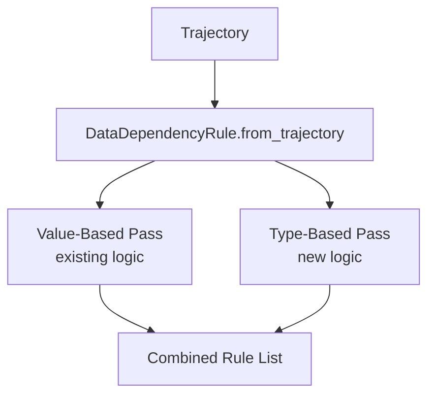

# Design Document — Type-Based Data Flow Rule

## Overview

This design extends the existing `DataDependencyRule` class with a second pass that detects potential data-flow relationships based on parameter type matching. When a `tool_call` input parameter shares a `detected_type` (from the eligible set) with an earlier `tool_result`'s `output_typed` sub-parameter tree, the system emits a `DataDependencyRule` with `confidence=potential`. This complements the existing value-based lineage detection within the same `from_trajectory()` classmethod.

The type-based pass is a heuristic — it cannot confirm that data actually flowed between steps, only that the types are compatible. The `potential` confidence level distinguishes these inferences from the higher-confidence value-based rules.

---

## Architecture

### Pipeline Integration



The type-based pass runs after the existing value-based pass within the same `from_trajectory()` classmethod. Both passes produce `DataDependencyRule` instances that are concatenated into a single output list.

### Component Responsibilities

| Component | Location | Responsibility |
|-----------|----------|----------------|
| `ConfidenceLevel.potential` | `trajectory_eval/models/rule.py` | New enum value below `low` |
| `ELIGIBLE_TYPES` | `trajectory_eval/generator/rules/data_dependency.py` | Constant set of types eligible for matching |
| `_collect_type_sources()` | `trajectory_eval/generator/rules/data_dependency.py` | Recursively extracts eligible types from `output_typed` trees |
| `_extract_types_from_param()` | `trajectory_eval/generator/rules/data_dependency.py` | Recursively extracts eligible types from a ToolParameter/SubParameter tree |
| `_type_based_rules()` | `trajectory_eval/generator/rules/data_dependency.py` | Orchestrates the type-based pass over the trajectory |

---

## Components and Interfaces

### 1. ConfidenceLevel Extension

```python
class ConfidenceLevel(str, Enum):
    high = "high"
    medium = "medium"
    low = "low"
    potential = "potential"
```

Ordering by strength: `high > medium > low > potential`. This is implicit in the enum definition order and used only for documentation/display purposes (not for `__lt__` comparisons).

### 2. Eligible Types Constant

```python
from trajectory_eval.models.tool import ParameterType

ELIGIBLE_TYPES: frozenset[ParameterType] = frozenset({
    ParameterType.file_path,
    ParameterType.command_line,
    ParameterType.code,
    ParameterType.json,
    ParameterType.xml,
    ParameterType.url,
    ParameterType.yaml,
    ParameterType.date,
})
```

This excludes `plain_text`, `number`, and `boolean` which are too generic to indicate meaningful data flow.

### 3. Type Source Collection

```python
@staticmethod
def _extract_types_from_param(
    param: ToolParameter | SubParameter,
) -> set[ParameterType]:
    """Recursively extract all eligible detected_types from a parameter tree.

    Traverses the parameter and all nested sub_parameters at arbitrary depth.
    Returns only types that are in ELIGIBLE_TYPES.

    Args:
        param: A ToolParameter or SubParameter to traverse.

    Returns:
        Set of eligible ParameterType values found in the tree.
    """
    ...
```

```python
@classmethod
def _collect_type_sources(
    cls,
    steps: list[Step],
    up_to_index: int,
) -> dict[ParameterType, list[tuple[str, int]]]:
    """Collect type-sources from all tool_result steps before the given index.

    Scans tool_result steps in trajectory order. For each step with non-null
    output_typed, recursively extracts eligible types and records the
    (tool_name, step_index) pair for each.

    Args:
        steps: All trajectory steps.
        up_to_index: Only consider steps with index < up_to_index.

    Returns:
        Mapping from ParameterType to list of (tool_name, step_index) pairs.
    """
    ...
```

### 4. Type-Based Pass Orchestrator

```python
@classmethod
def _type_based_rules(
    cls,
    trajectory: Trajectory,
) -> list["DataDependencyRule"]:
    """Generate type-based DataDependencyRules from a trajectory.

    Algorithm:
    1. Iterate tool_call steps in trajectory order.
    2. For each tool_call, collect type-sources from all preceding tool_result steps.
    3. For each input ToolParameter on the tool_call, recursively extract eligible types.
    4. For each eligible type found in input, check if a matching type-source exists.
    5. Apply filters: self-referential exclusion, deduplication.
    6. Emit DataDependencyRule with confidence=potential.

    Args:
        trajectory: The complete trajectory to analyze.

    Returns:
        List of type-based DataDependencyRule instances.
    """
    ...
```

### 5. Modified `from_trajectory()`

```python
@classmethod
def from_trajectory(
    cls,
    trajectory: Trajectory,
) -> list["DataDependencyRule"]:
    """Generate all DataDependencyRules — value-based and type-based.

    Executes the existing value-based lineage pass followed by the
    type-based heuristic pass. Returns a single combined list.
    """
    # Existing value-based pass
    value_rules: list[DataDependencyRule] = []
    for step in trajectory.steps:
        if step.step_type != StepType.tool_call or not step.tool_input:
            continue
        value_rules.extend(cls._rules_for_step(step, trajectory.steps))

    # New type-based pass
    type_rules = cls._type_based_rules(trajectory)

    return value_rules + type_rules
```

---

## Data Models

### TypeMatch (Deduplication Key)

A `TypeMatch` is a named tuple used internally for deduplication:

```python
from typing import NamedTuple

class TypeMatch(NamedTuple):
    """Deduplication key for type-based rules."""
    tool_name: str
    param_key: str
    source_tool_name: str
    detected_type: ParameterType
```

### Emitted Rule Structure

Type-based rules reuse the existing `DataDependencyRule` model with these field values:

| Field | Value |
|-------|-------|
| `id` | `"type_dep_{step_index}_{param_key}_{source_step}"` |
| `step_index` | Index of the tool_call step |
| `param_key` | Key of the matched input ToolParameter |
| `param_value` | `f"type:{detected_type.value}"` (synthetic — no actual value matched) |
| `source_step` | Index of the tool_result step that produced the type-source |
| `source_tool_name` | Name of the tool at the source step |
| `tool_name` | Name of the tool at the tool_call step |
| `confidence` | `ConfidenceLevel.potential` |

---

## Algorithm Detail

### Type-Based Pass (Pseudocode)

```python
def _type_based_rules(cls, trajectory: Trajectory) -> list[DataDependencyRule]:
    rules = []
    seen: set[TypeMatch] = set()

    for step in trajectory.steps:
        if step.step_type != StepType.tool_call or step.tool is None:
            continue

        tool_name = step.tool.name

        # Collect all type-sources from preceding tool_result steps
        type_sources = cls._collect_type_sources(trajectory.steps, step.index)

        # Extract eligible types from each input parameter
        for input_param in step.tool.inputs:
            input_types = cls._extract_types_from_param(input_param)

            for detected_type in input_types:
                if detected_type not in type_sources:
                    continue

                # Match against each source
                for source_tool_name, source_step_index in type_sources[detected_type]:
                    # Self-referential exclusion
                    if source_tool_name == tool_name:
                        continue

                    # Deduplication
                    match_key = TypeMatch(
                        tool_name=tool_name,
                        param_key=input_param.key,
                        source_tool_name=source_tool_name,
                        detected_type=detected_type,
                    )
                    if match_key in seen:
                        continue
                    seen.add(match_key)

                    rules.append(DataDependencyRule(
                        id=f"type_dep_{step.index}_{input_param.key}_{source_step_index}",
                        step_index=step.index,
                        param_key=input_param.key,
                        param_value=f"type:{detected_type.value}",
                        source_step=source_step_index,
                        source_tool_name=source_tool_name,
                        tool_name=tool_name,
                        confidence=ConfidenceLevel.potential,
                    ))

    return rules
```

### Recursive Type Extraction (Pseudocode)

```python
def _extract_types_from_param(param: ToolParameter | SubParameter) -> set[ParameterType]:
    result: set[ParameterType] = set()

    if param.detected_type in ELIGIBLE_TYPES:
        result.add(param.detected_type)

    for sub in param.sub_parameters:
        result.update(_extract_types_from_param(sub))

    return result
```

---

## Error Handling

### Null Safety

- Steps with `tool is None` are skipped (existing pattern).
- Steps with `tool.output_typed is None` are skipped — no type-source extracted.
- Input parameters with empty `sub_parameters` simply produce no nested types (base case of recursion).

### Graceful Degradation

- If the `ConfidenceLevel.potential` value is not yet defined when running tests, the code raises a standard `AttributeError` — no special handling needed since this is a prerequisite.
- Empty trajectories (no steps) produce an empty list from the type-based pass.
- Trajectories with no tool_result steps produce no type-sources, so no type-based rules.
- Trajectories where all types are excluded (plain_text, number, boolean only) produce no type-based rules.

### No Exception Swallowing

The type-based pass does not add try/except blocks around its internal logic. If a programming error occurs (e.g., unexpected None), it propagates. The calling `from_trajectory()` method is already invoked within the fault-tolerant `HardRuleRunner` which handles rule-class-level exceptions.

---

## Testing Strategy

### Dual Testing Approach

**Property-based tests** (Hypothesis) validate the 6 correctness properties below. The type-based pass is a pure function operating on structured data — ideal for PBT.

**Unit tests** cover:
- Specific example trajectories demonstrating correct rule emission.
- Edge cases: empty trajectory, all-excluded types, deeply nested parameters.
- Self-referential exclusion with concrete tool names.
- Integration: combined output from both value-based and type-based passes.

### Property-Based Testing Configuration

- Library: **Hypothesis**
- Minimum iterations: 100 per property
- Custom strategies: Generate `Trajectory` instances with controlled `ToolParameter` trees at varying depths and type distributions.

---

## Correctness Properties

*A property is a characteristic or behavior that should hold true across all valid executions of a system — essentially, a formal statement about what the system should do. Properties serve as the bridge between human-readable specifications and machine-verifiable correctness guarantees.*

### Property 1: Eligible Type Filtering

*For any* trajectory processed by the type-based pass, every emitted type-based rule SHALL have its underlying matched `detected_type` in the set `{file_path, command_line, code, json, xml, url, yaml, date}`. Equivalently, no type-based rule SHALL ever be emitted for a match involving `plain_text`, `number`, or `boolean`.

**Validates: Requirements 2.1, 2.2**

### Property 2: Type-Source Collection Requires Non-Null output_typed

*For any* trajectory, a tool_result step with `tool.output_typed is None` SHALL never contribute a type-source to the type-based pass. Equivalently, for any emitted type-based rule, the `source_step` SHALL reference a step whose `tool.output_typed` is non-null.

**Validates: Requirements 3.1, 3.2, 3.3**

### Property 3: Recursive Depth Discovery

*For any* ToolParameter tree with eligible types located at arbitrary nesting depth N (where N >= 0), the type extraction function SHALL discover those types. Specifically, if a SubParameter at depth N has an eligible `detected_type`, it SHALL be included in the extraction result.

**Validates: Requirements 3.2, 4.2, 9.1**

### Property 4: Type-Based Rule Emission Correctness

*For any* emitted type-based DataDependencyRule, all of the following SHALL hold: (a) `confidence == ConfidenceLevel.potential`, (b) `param_key` matches the key of the input ToolParameter whose tree contained the matching type, (c) `source_tool_name` matches the name of the tool at the source tool_result step, (d) `source_step` matches the step index of the source tool_result, and (e) the source step's `output_typed` tree contains the same eligible type as the input parameter tree.

**Validates: Requirements 5.1, 5.2, 5.3, 5.4, 5.5**

### Property 5: Self-Referential Exclusion

*For any* trajectory where a tool_call's input parameter has an eligible type matching a type-source from a tool_result with the same tool name, the type-based pass SHALL NOT emit a rule for that match.

**Validates: Requirements 6.1**

### Property 6: Deduplication Invariant

*For any* trajectory, the type-based pass SHALL emit at most one rule per unique `(tool_name, param_key, source_tool_name, detected_type)` tuple. If multiple steps would produce the same tuple, only the first encountered (in trajectory order) results in an emitted rule.

**Validates: Requirements 7.1, 7.2**

### Property 7: Unified Output Completeness

*For any* trajectory that would produce value-based rules AND type-based rules independently, calling `DataDependencyRule.from_trajectory()` SHALL return a single list containing rules from both passes, with type-based rules following value-based rules. The type-based pass SHALL process steps in ascending step-index order.

**Validates: Requirements 8.1, 8.2, 8.3**
